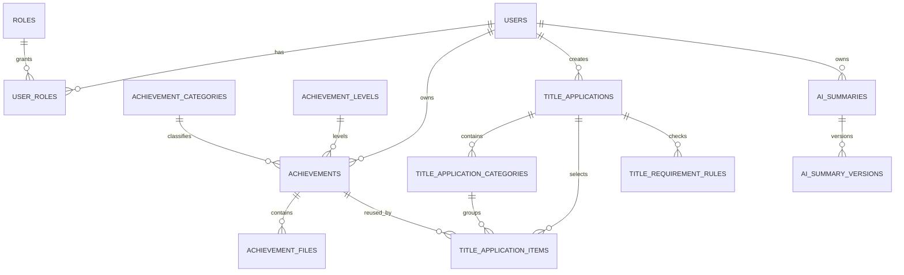

# 教师综合成果与职称材料管理平台——总体设计

## 1. 系统架构

系统采用前后端分离的模块化单体架构，便于个人部署，也便于未来按模块拆分服务。

```text
Vue 3 SPA -> REST API / JWT -> FastAPI
                              |-- SQLAlchemy -> SQLite / MySQL 8+
                              |-- LocalStorage -> storage/
                              |-- LLMService -> DeepSeek API
                              `-- Export/Backup services
```

开发环境使用 SQLite 和本地文件系统；生产环境通过 `DATABASE_URL` 切换 MySQL，通过存储服务接口预留 MinIO/OSS/S3。用户、角色、所有业务表均带 `user_id` 或归属关系，第一阶段只创建一个教师账号，数据模型不限制未来扩展。

## 2. 功能模块树

```text
工作台
├─ 指标卡、趋势、分布、最近成果、职称完成度
个人档案
成果管理
├─ CRUD、复制、批量删除、组合筛选、Excel 导入导出
├─ 分类/级别配置、积分规则
└─ 多附件管理
年度成果
├─ 年度统计、清单、Excel/Word/ZIP、AI 年度总结
职称申报
├─ 项目、目录、成果多对多关联
├─ 自定义条件与完整度检查
└─ Excel/Word/材料目录 ZIP、AI 业绩总结
电子材料
成果分析
AI 成果总结
├─ 年度/区间/类别/职称总结
├─ Prompt 模板、版本记录
└─ 编辑、复制、Word 下载
系统设置
├─ 分类、级别、积分、Prompt、上传与 DeepSeek
└─ 数据备份与恢复
```

明确不包含课程、教案、授课计划或任何 AI 教学文档生成功能。

## 3. 数据库 ER 模型



## 4. 数据表结构

核心表：`users`, `roles`, `user_roles`, `achievements`, `achievement_files`, `achievement_categories`, `achievement_levels`, `achievement_score_rules`, `title_applications`, `title_application_categories`, `title_application_items`, `title_requirement_rules`, `ai_prompt_templates`, `ai_summaries`, `ai_summary_versions`, `system_settings`, `backup_records`。

统一约定：主键为整数；业务时间使用 ISO 日期；所有核心表含 `created_at`、`updated_at`，成果和文件支持 `deleted_at` 软删除；JSON 配置用于可变规则但不存储关键关联。

## 5. 前端页面设计

桌面端采用固定侧栏、顶部用户区、响应式内容区。列表页统一由“筛选区 + 操作区 + 表格 + 分页/抽屉表单”构成；工作台和分析中心使用 ECharts；职称详情采用目录树与成果表双栏；移动窄屏时侧栏折叠。危险操作二次确认，空状态给出直接操作入口。

## 6. REST API 设计

统一前缀 `/api/v1`。主要资源为：`auth`, `profile`, `achievements`, `files`, `annual`, `title-applications`, `analytics`, `ai-summaries`, `settings`, `backups`。使用 JWT Bearer；列表接口支持分页与组合筛选；导出接口返回流；上传使用 multipart；错误统一为 `{detail, code}`。

## 7. 文件存储方案

文件按 `storage/achievements/{year}/{achievement_id}/UUID.ext` 保存，数据库保留原名、唯一存储名、相对路径、MIME、大小和类别。下载时强制鉴权及归属检查，路径解析后必须位于存储根目录内。预览只开放浏览器安全格式。导出和备份分别写入 `exports/`、`backups/`。存储访问集中在服务层，便于替换对象存储。

## 8. 职称成果关联方案

`title_application_items` 是职称项目与成果的多对多中间表，并额外保存材料目录 ID、排序和说明；同一成果可关联多个项目，但同一项目/目录/成果组合唯一。删除关联不删除成果本体。目录可自由增删改排。

## 9. DeepSeek AI 成果总结方案

后端按用户和筛选条件查询真实成果，转换为带编号的只读结构化事实，再交给统一 `LLMService`。系统 Prompt 强制禁止补充事实；用户模板只能控制结构和文风。请求记录保存成果 ID、Prompt 快照、模型和输出；每次生成/编辑都追加版本，不覆盖旧版。服务处理未配置、空数据、超时、网络、鉴权、额度和空响应。密钥只从环境变量或加密配置读取，永不返回前端。

## 10. 数据备份方案

备份包包含数据库一致性快照、`storage/achievements` 文件、manifest（版本、时间、文件校验值），输出 ZIP。恢复先校验 manifest、版本、路径安全和校验值，再创建恢复前快照；恢复是管理员显式操作。MySQL 生产环境使用 `mysqldump` 适配器，本地 SQLite 使用在线 backup API。建议每日增量、每周完整备份并复制到异地介质。
